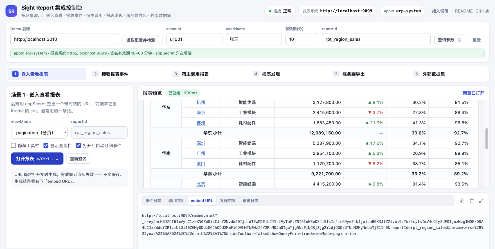
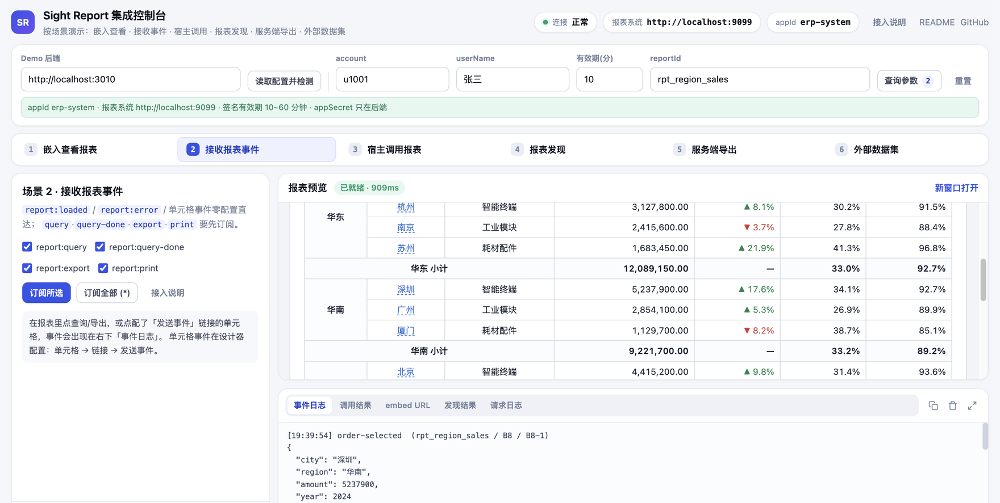
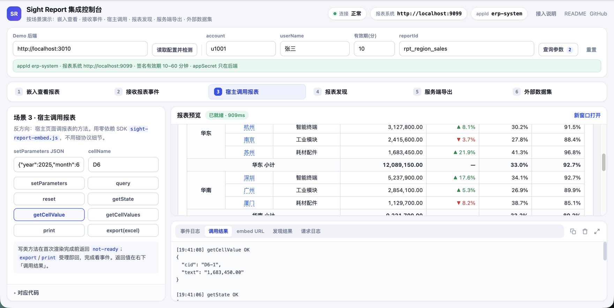
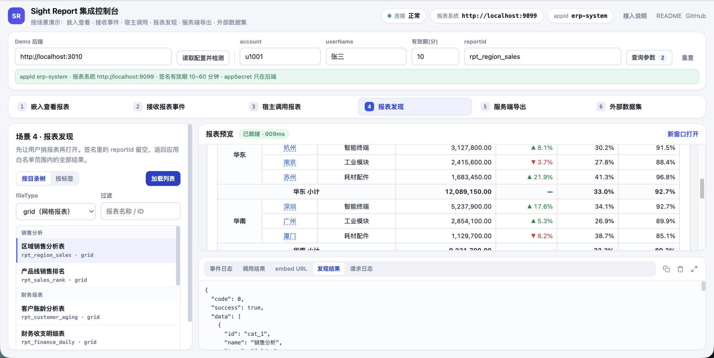
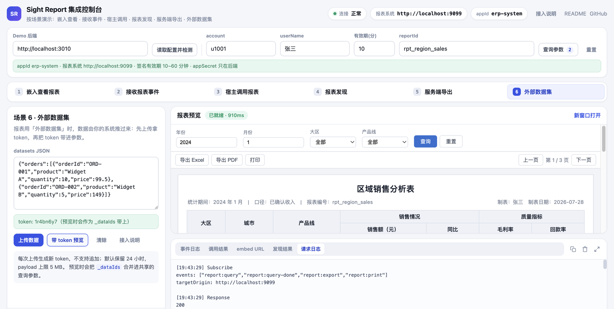
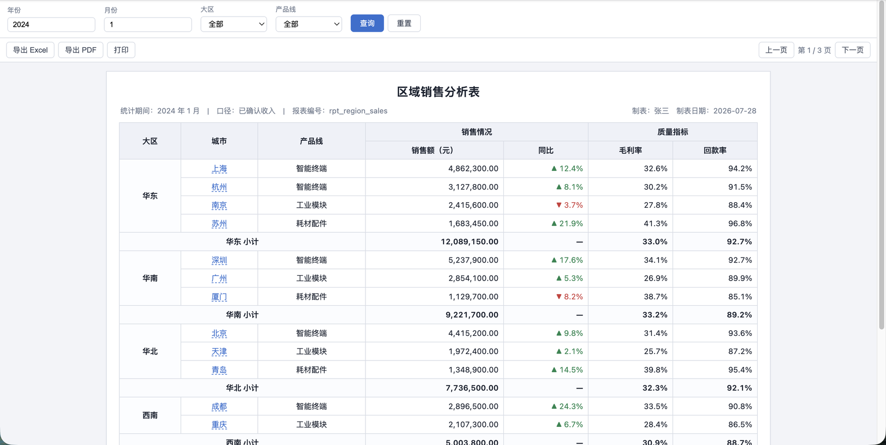

# Sight Report 集成示例（sight-report-integration-demo）

[English](./README.md) · 简体中文

把 **Sight Report** 报表嵌进你自己的系统，需要的全部东西都在这个仓库里：一个替你保管
`appSecret` 并生成签名的**后端样例**，一个零依赖的**前端控制台**，以及一个零依赖的
**宿主 SDK**（`sight-report-embed.js`）。

不需要报表系统源码，也不需要构建工具，`npm install && npm start` 就能跑。

```
第三方业务前端                  第三方后端（本仓库 backend-node）          Sight Report
────────────────               ─────────────────────────────            ─────────────
点开某张报表        ──────▶     用 appSecret 做 HMAC-SHA256 签名
                                生成 embed URL（不含明文密钥）
   iframe.src = embedUrl  ◀──── 返回 URL
   ├─ 加载报表  ─────────────────────────────────────────────────▶  校验签名并渲染
   ├─ 收事件    ◀────── postMessage: report:loaded / 单元格事件 ─────  报表页面
   └─ 调方法    ─────── postMessage: invoke setParameters ──────▶
服务端导出 / 外部数据集  ──────▶ 同样的签名 ────────────────────────▶  /api/embed/*
```

## 目录

- [截图](#截图)
- [快速开始](#快速开始)
- [目录结构](#目录结构)
- [集成说明](#集成说明)
  - [签名规则](#签名规则公共)
  - [场景一：嵌入查看报表](#场景一嵌入查看报表)
  - [场景二：接收报表事件](#场景二接收报表事件)
  - [场景三：宿主调用报表方法（SDK）](#场景三宿主调用报表方法sdk)
  - [场景四：获取报表列表](#场景四获取报表列表)
  - [场景五：服务端直接导出](#场景五服务端直接导出)
  - [场景六：外部数据集](#场景六外部数据集)
- [Demo 后端接口一览](#demo-后端接口一览)
- [上生产前的检查清单](#上生产前的检查清单)
- [排查常见问题](#排查常见问题)
- [许可](#许可)

## 截图

**场景 1 · 嵌入查看报表** —— 左侧场景面板、中间嵌入的报表、右下是后端刚签出的 embed URL：



**场景 2 · 接收报表事件** —— 点报表里配了「发送事件」的单元格，宿主收到自定义事件与 payload：



**场景 3 · 宿主调用报表** —— 通过 SDK 调 `getState` / `getCellValue`，返回值进「调用结果」：



<details>
<summary>更多截图：报表发现 / 外部数据集 / 报表本体</summary>

**场景 4 · 报表发现**：目录树结果被扁平成可点列表，选中即写回共享 `reportId`，原始 JSON 留在「发现结果」。



**场景 6 · 外部数据集**：上传数据拿到 token，预览时作为 `_dataIds` 带上。



**嵌入的报表本体**（新窗口打开的效果）：



</details>

> 关于截图：控制台、签名链路、事件与 invoke 协议都是**真实运行**的；报表内容是**演示用示例数据**，
> 由一个本地 mock 报表服务渲染（不含任何真实业务数据）。你接上自己的 Sight Report
> 部署后，中间那块就是你自己的报表。

## 快速开始

**前置条件**

1. 一个可访问的 Sight Report 部署地址
2. 在报表系统里 **系统管理 → 第三方应用 → 新增应用**，拿到 `appId` 与 `appSecret`
   （`appSecret` 只显示一次，请当场保存）
3. Node.js ≥ 18（用到了内置 `fetch`）

**跑起来**

```bash
cd backend-node
cp .env.example .env      # 填 SIGHT_REPORT_BASE_URL / APP_ID / APP_SECRET
npm install
npm start
```

打开 <http://localhost:3010/demo/>。控制台**按场景组织**，和下面「集成说明」一一对应：

- 顶部一条**共享上下文**：demo 后端地址、`account` / `userName`、签名有效期、`reportId`、查询参数。
  这些值被所有场景共用，也都会被写进签名。
- 中间一排**场景页签**，一次只看一个：嵌入查看 → 接收事件 → 宿主调用 → 报表发现 → 服务端导出 → 外部数据集。
  每个场景里是：一句话目标 + 该场景专属字段 + 主操作按钮 + **用当前表单值生成的可复制代码** + 结果。
- 右侧常驻**报表预览**与**观察窗**（事件日志 / 调用结果 / embed URL / 发现结果 / 请求日志）。
  用横向页签而不是侧边栏，是为了把宽度尽量留给报表预览——小屏笔记本上也够用。

第一次用的顺序：顶部点「读取配置并检测」→ 场景 4 选一张报表 → 场景 1 打开（`⌘/Ctrl + ↵`）。
场景地址带 hash（如 `#/events`），可以直接把某个场景的链接发给同事。

Windows 用户可以直接双击 `start-demo.cmd`；macOS / Linux 用 `./start-demo.sh`。
也支持 Docker：`cd backend-node && docker compose up --build`。

## 目录结构

```
backend-node/                 后端样例（Express，唯一持有 appSecret 的地方）
  src/signature-service.js    ★ 签名算法，40 行，可直接照搬到你的后端
  src/report-url-service.js   ★ 拼签名 URL
  src/staged-dataset-service.js 外部数据集上传 / 清除
  src/index.js                demo 用的 HTTP 接口 + 静态托管
  requests.http               VS Code REST Client 可直接跑的请求集
frontend-static/              前端控制台（原生 HTML/CSS/JS，无构建）
  sight-report-embed.js       ★ 宿主 SDK，零依赖 UMD，可直接拷进你的项目
  sight-report-embed.d.ts     SDK 类型声明
  index.html / app.js / styles.css
docs/integration-checklist.md 交付 / 联调检查清单
docs/screenshots/             截图目录
```

打星的三个文件是**真正要搬进你项目的东西**，其余都是为了让 demo 能跑起来。

## 集成说明

### 签名规则（公共）

所有嵌入与 `/api/embed/*` 调用共用一套签名，签名结果放在查询参数 `_s` 里。

| 项 | 规则 |
| --- | --- |
| 签名内容 | `appId \| account \| userName \| reportId \| expireAt`（竖线连接） |
| 算法 | `HMAC-SHA256(签名内容, appSecret)`，输出小写十六进制 |
| 参数体 | 上述字段加 `signature` 组成 JSON，再做 **Base64Url**（无填充）编码 |
| 放置位置 | 查询参数 `_s` |
| `expireAt` | Unix 秒。查看类建议 5~15 分钟；每次打开实时生成，**不要缓存 URL** |
| `reportId` | 查看报表建议绑定具体值；获取列表通常留空；服务端导出**必须**与 `fileId` 一致 |

`account` / `userName` 是第三方系统的当前登录人。外部用户会自动映射为报表系统内部用户，
账号形如 `ext__{appId}__{account}`。

**Node.js**（完整实现见 `backend-node/src/signature-service.js`）

```js
const crypto = require('crypto')

function buildSignatureToken({ appId, appSecret, account, userName, reportId, expireAt }) {
  const signContent = [appId, account, userName, reportId || '', String(expireAt)].join('|')
  const signature = crypto.createHmac('sha256', appSecret).update(signContent, 'utf8').digest('hex')
  const payload = JSON.stringify({ appId, account, userName, reportId, expireAt, signature })
  return Buffer.from(payload, 'utf8')
    .toString('base64')
    .replace(/\+/g, '-')
    .replace(/\//g, '_')
    .replace(/=+$/g, '')
}
```

**Java**

```java
long expireAt = System.currentTimeMillis() / 1000 + expireMinutes * 60L;
String signContent = String.join("|", appId, account, userName,
        reportId == null ? "" : reportId, String.valueOf(expireAt));

Mac mac = Mac.getInstance("HmacSHA256");
mac.init(new SecretKeySpec(appSecret.getBytes(StandardCharsets.UTF_8), "HmacSHA256"));
StringBuilder hex = new StringBuilder();
for (byte b : mac.doFinal(signContent.getBytes(StandardCharsets.UTF_8))) {
    hex.append(String.format("%02x", b));
}

String payload = String.format(
        "{\"appId\":\"%s\",\"account\":\"%s\",\"userName\":\"%s\","
      + "\"reportId\":\"%s\",\"expireAt\":%d,\"signature\":\"%s\"}",
        appId, account, userName, reportId, expireAt, hex);

String s = Base64.getUrlEncoder().withoutPadding()
        .encodeToString(payload.getBytes(StandardCharsets.UTF_8));
String embedUrl = baseUrl + "/embed.html?reportId=" + reportId + "&_s=" + s;
```

**Python**

```python
import base64, hashlib, hmac, json, time

def build_signature(app_id, app_secret, account, user_name, report_id="", expire_minutes=10):
    expire_at = int(time.time()) + expire_minutes * 60
    sign_content = "|".join([app_id, account, user_name, report_id, str(expire_at)])
    signature = hmac.new(app_secret.encode(), sign_content.encode(), hashlib.sha256).hexdigest()
    payload = json.dumps({
        "appId": app_id, "account": account, "userName": user_name,
        "reportId": report_id, "expireAt": expire_at, "signature": signature,
    }, ensure_ascii=False)
    return base64.urlsafe_b64encode(payload.encode()).rstrip(b"=").decode()
```

> **`appSecret` 只能待在服务端。** 一旦下发到浏览器，任何人都能伪造任意用户身份的报表访问。

### 两种认证方式

拿到签名后有两种用法，按调用场景选一种即可（`/api/embed/**` 不走平台登录态，只认下面两者之一）：

| 方式 | 怎么带 | 适用 |
| --- | --- | --- |
| **A. 一次性签名**（无状态，本 demo 用的就是它） | 每次请求带查询参数 `_s` | 嵌入 URL、报表发现、服务端导出。服务端不保存状态，签名到期即失效 |
| **B. 换取会话** | `POST /api/embed/auth` 用签名换 `sessionToken`，之后请求带 Header `X-Embed-Session` | 服务端要连续调多个接口时省去每次重算签名；嵌入页面内部用的就是这条 |

```http
POST /api/embed/auth
{ "signature": "<_s 的值>", "reportId": "rpt_sales" }

→ { "code": 0, "data": { "sessionToken": "...", "userId": "...", "userName": "张三",
      "externalAccount": "ext__erp-system__u1001", "appId": "erp-system",
      "reportId": "rpt_sales", "expireAt": 1735660800000 } }
```

- 会话有效期取「签名有效期」与「应用上限」（默认 60 / 最长 1440 分钟）的较小值；
  `GET /api/embed/session/validate` 校验、`POST /api/embed/session/logout` 主动失效。
- 会话模式下报表访问范围仍受限：签名绑定了 `reportId` 就只能访问该报表，未绑定则按应用白名单放行。
- **嵌入报表时你不需要自己换会话**——把带 `_s` 的 URL 交给 iframe 即可，页面内部会自己完成。

### 场景一：嵌入查看报表

```
GET {baseUrl}/embed.html?reportId={reportId}&_s={signature}
```

| 查询参数 | 说明 |
| --- | --- |
| `reportId` | 报表 ID，必填 |
| `_s` | 签名参数 |
| `parameters` | 报表查询参数，JSON 序列化后再 URL 编码，如 `{"year":2024,"month":1}` |
| `hideToolbar` | `true` 隐藏工具栏（打印 / 导出 / 分页） |
| `toolbarItems` | 逐个控制工具栏按钮：逗号分隔，`-按钮` 隐藏、`+按钮` 显示，没写到的按报表设置、再按系统设置（网格报表与单据各一张隐藏清单）。如 `-license,-timing,-query`。按钮：`print` `continuePrint` `export` `viewMode` `zoom` `query` `resetColumnWidths` `columns` `pagination` `caliber` `timing` `license` `sheetTabs`。只决定「允许出现」，打印权限等前提仍要满足；仪表盘不受影响 |
| `toolbarButtons` | 宿主自己的工具栏按钮：JSON 数组 `[{ id, text, title?, position?: 'left'\|'right', type?: 'default'\|'primary', disabled? }]` 先 UTF-8 再 base64url（Node：`Buffer.from(json).toString('base64url')`；浏览器：`SightReportEmbed.encodeToolbarButtons(buttons)`）。点击时报表发 `report:toolbar-click`（直接发送，不用订阅），payload `{ id, parameters }` |
| `showQueryForm` | `false` 隐藏查询表单 |
| `viewMode` | `pagination`（分页，默认）/ `all`（全部数据） |
| `zoom` | 显示比例：`fitWidth`（适应宽度，网格 / 单据整体等比缩放到正好铺满 iframe 宽度，iframe 尺寸变化时自动重算）或 10~300 的百分比（如 `75`）。不传则按查看人上次在工具栏选的比例（记在其浏览器）、再按报表设置「默认显示比例」。只影响屏幕显示，不影响打印与导出；与 `hideToolbar` 互不影响。旧写法 `fitWidth=true` / `false` 等同 `zoom=fitWidth` / `zoom=100` |

> 宿主自己做了查询按钮时，用 `toolbarItems=-query` 藏掉报表的「查询」，按钮里调 `report.query()`；打开后还能用 `report.setToolbarItems('-print')` / `report.setToolbarButtons([...])` 再改。这几项需要平台版本带有「工具栏按钮显隐」功能，旧版本会忽略 URL 参数，方法返回 `unknown method`。

> `zoom` 与 `setZoom` 需要平台版本带有「显示比例」功能；旧版本会忽略 `zoom` 参数，`setZoom` 返回 `unknown method`。

```js
// 宿主前端：URL 由自己的后端返回，前端不参与签名
const embedUrl = await fetch('/my-backend/report-embed-url?reportId=rpt_sales').then((r) => r.text())
document.getElementById('reportFrame').src = embedUrl
// 或 window.open(embedUrl, '_blank')
```

### 场景二：接收报表事件

报表通过 `postMessage` 向宿主发事件，信封统一为：

```ts
{ protocol: 'sight-report', name: string, payload: object,
  source: { reportId: string, cellName?: string, cid?: string }, timestamp: number }
```

事件分两级：

| 级别 | 事件 | payload |
| --- | --- | --- |
| 零配置直发 | `report:loaded` | `{ elapsedMs }`，首次渲染完成，仅一次 |
| 零配置直发 | `report:error` | `{ phase: 'load'\|'query'\|'export', message }` |
| 零配置直发 | 自定义单元格事件 | 设计器「发送事件」链接配置的参数，按点击行求值 |
| 订阅后发 | `report:query` | `{ parameters }`，用户点查询 |
| 订阅后发 | `report:query-done` | `{ parameters, elapsedMs }`，每次查询渲染完成（含首次） |
| 订阅后发 | `report:export` | `{ format }`—导出**发起时**发，没有完成事件 |
| 订阅后发 | `report:print` | `{ command }` |
| 订阅后发 | `report:resize` | 报表尺寸变化（宿主按需调整 iframe 高度） |

**第一步：零配置监听**

```js
window.addEventListener('message', (event) => {
  if (event.origin !== 'https://报表系统地址') return      // 校验来源
  if (event.data?.protocol !== 'sight-report') return      // 校验协议命名空间
  const { name, payload, source } = event.data
  switch (name) {
    case 'report:loaded':
      console.log('报表就绪', payload.elapsedMs, 'ms')
      break
    case 'report:error':
      console.error('报表出错', payload.phase, payload.message)
      break
    case 'order-selected':      // 设计器里自定义的单元格事件名
      openOrderDetail(payload.orderId)   // source.cid 可区分展开后第几行
      break
  }
})
```

**第二步（可选）：订阅过程性事件**

```js
frame.contentWindow.postMessage(
  { protocol: 'sight-report', type: 'subscribe', events: ['report:query', 'report:export'] }, // 或 ['*']
  'https://报表系统地址'
)
```

订阅同时会让报表侧锁定宿主 origin 作为后续 `postMessage` 的 `targetOrigin`，安全性更高。

**自定义事件怎么配**：三种报表各有入口，事件名都自定义（不能以 `report:` 开头，该前缀保留给系统事件），
参数即 payload，按被点的那一行 / 那一份求值。

| 报表类型 | 配置入口 | 载荷 |
| --- | --- | --- |
| 网格 grid | 选中单元格 → 链接 → 添加链接 → **发送事件** | 链接参数（支持表达式，如 `A2` 取当前行） |
| 单据 document | 选中画布组件 → 定位与操作 → 点击链接 → **发送事件** | 同上；单据里的表格组件是一张内嵌网格，按网格那条路配 |
| 仪表盘 dashboard | 选中区块 → 点击数据点 / 点整行 / 按列配置 → **发送事件到宿主页面**，并填事件名 | 归一后的数据点 `{ field, value, label, seriesName? }`，表格再带整行 `row` |

事件信封除 `payload` 外还有两处：`source` 是定位字段（网格给 `cellName`/`cid`，单据给 `componentId`，
仪表盘给 `blockId`/`tabId`），`context.parameters` 是事件发生时**生效**的查询条件。
`context` 刻意放在信封而不是塞进 `payload`——payload 的键名由报表设计者自定，混在一起会撞名。

**仪表盘的两处不同**：`report:loaded` 在**首屏区块取数完成**时才发（不是模板到手就发，payload 多带
`blockCount` / `failedCount`）；`report:query` / `query-done` 的 payload 带 `trigger: 'user' | 'auto'`，
定时刷新那一路也会发。

### 场景三：宿主调用报表方法（SDK）

反方向调用走同一条 `postMessage` 通道：请求
`{ protocol:'sight-report', type:'invoke', id, method, args }`，响应
`{ ..., type:'invoke-result', id, ok, data|error }`。

直接用 `frontend-static/sight-report-embed.js`（零依赖 UMD，附 `.d.ts`）就不用关心协议细节：

```js
const report = SightReportEmbed.mount('#reportBox', {
  getEmbedUrl: () => fetch('/my-backend/embed-url').then((r) => r.text())
})

await report.ready()                          // loaded 事件 + getState 轮询兜底
report.on('report:query-done', (e) => console.log(e.payload.elapsedMs))
await report.setParameters({ year: 2025 })    // 合并参数并重新出数（等完成）
const state = await report.getState()         // 先看 state.fileType，再决定用哪些方法
const p = await report.getParameters(['year']) // 读当前生效参数（不传 names ＝全给）
const cell = await report.getCellValue('C4')  // 单元格渲染后显示值（仅 grid）
await report.export('excel')                  // 受理即回；没有完成事件可等
const file = await report.getExportFile('pdf') // 拿文件内容（不下载）：{ blob, fileName, size }
await report.reload()                         // 重新取签名 URL 并重载
```

已有 iframe 元素时用 `SightReportEmbed.connect(iframeEl)`。

| 方法 | 说明 |
| --- | --- |
| `setParameters(params, { query })` | 合并参数；`query !== false` 时立即出数并等完成 |
| `query()` / `reset()` | 重新查询 / 重置参数 |
| `export(format)` / `print(command \| { printer, copies, command, pages })` | 受理即回，完成看对应事件；`pages` 只打指定页，见下方「指定页」 |
| `getExportFile(format, { maxBytes, timeoutMs, pages })` | 拿到文件才 resolve，回 `{ blob, fileName, contentType, size, format }`；与工具栏导出同一份文件。见下方「取文件内容」 |
| `getParameters(names?, { raw })` | 读参数。`names` 省略＝全给，挑不到的键不出现在结果里；`raw` 只对仪表盘有区别（缺省是含日期展开与联动叠加的**生效值**） |
| `getState()` | 先看 `fileType`：grid / document 回参数、变量、页码、sheet、显示比例（`zoom` 设定值、`scale` 实际缩放比）；dashboard 回页签、联动、数据更新时间 |
| `setZoom(zoom)` | 显示比例：`'fitWidth'` 或百分比（`75` / `'75%'`），与工具栏「显示比例」下拉同一状态，工具栏隐藏时也能调 —— **grid / document** |
| `setSheet(sheetId)` | 多 sheet（页签）报表切换 —— **仅 grid** |
| `getCellValue(name)` / `getCellValues(name)` | 单元格渲染后显示值（首个 / 全部）—— **仅 grid** |
| `setTab(tabId)` / `getTabs()` | 仪表盘页签切换 —— **仅 dashboard** |
| `invoke(method, ...args)` | 泛化调用，协议加方法时旧 SDK 不用升级 |

**方法不是每种报表都有**。不支持的会明确回 `ok:false`、`error` 以 `unsupported:` 开头，
**不会静默成功**——先 `getState().fileType` 判类型，再决定调什么。
写类方法在报表首次加载完成前返回 `not-ready`；过程性事件由 SDK 自动订阅。
如果宿主是 Vue 应用且能引入报表组件，也可以用组件方式
`<ReportView ref="reportRef" :file-id="reportId" @report-event="onReportEvent" />`——
组件通道不需要订阅，事件全量触发，方法经 `ref` 直接调。

#### 取文件内容（发远程打印 / 归档 / 上传）

报表已经在 iframe 里展示、宿主还要拿到文件本身时，用 `getExportFile`，**不需要后端再签名或代理文件流**：
报表页面用自己的嵌入会话请求导出，再把 Blob 经 `postMessage` 交回宿主。

```js
const file = await report.getExportFile('pdf', { maxBytes: 50 * 1024 * 1024 })
// file = { blob, fileName: '销售月报.pdf', contentType: 'application/pdf', size: 482113, format: 'pdf' }
await fetch('/my-backend/remote-print', { method: 'POST', body: file.blob })
```

- **与工具栏导出同一份文件**：格式参数就是导出菜单的命令名——`pdf`（全部）、`pdfCurrent`（当前页）、
  `pdfCurrentSheet`（多 sheet 时仅当前 sheet），`word` / `excel` / `csv` / `ofd` 同理；
  参数取「最后一次查询」的提交快照，改了查询表单没点查询不会混进来。
- **仪表盘与大屏不支持**（回 `unsupported:`；仪表盘的 `export('pdf')` 是前端整页截图，没有服务端文件可取）；
  大数据量明细 Excel 走异步任务，也回 `unsupported:`，请用 `export('excel')`。

**大文件**：

| 关注点 | 处理 |
| --- | --- |
| 传输 | 报表侧用 `response.blob()`，经 `postMessage` 传 Blob 只传引用、**不复制字节**；浏览器可把大 Blob 放磁盘 |
| 内存上限 | `maxBytes` 默认 **100 MB**，`0` 不限。先看 `Content-Length`，超了**直接中断下载**，不读进内存；分块传输没有长度时读完再判 |
| 超时 | `timeoutMs` 默认 **120 秒**（普通 invoke 是 30 秒）。到点报表侧中断请求，回 `timeout:` |
| 并发 | 同一报表同时只允许一个 `getExportFile`，第二个回 `busy:`——并发取大文件会让宿主和 iframe 的内存一起翻倍 |
| 服务端 | PDF / Word 是**同步生成**，超大报表首字节就可能很慢，网关超时要留够；真要几百页，先用参数缩小范围或按页（`pdfCurrent`）分批取 |
| 宿主转发 | 拿到 Blob 直接作为 `fetch` 的 `body` 上传即可，不要转 base64——会多出 1/3 体积，还要整份进内存 |

失败一律 reject，`error.message` 带前缀便于分支：`too-large:` / `timeout:` / `busy:` / `unsupported:` /
`session-expired:`（会话过期且自动续期失败，`reload()` 后重试）/ `export-failed:` / `invalid format:` / `not-ready`。

> 需要报表系统版本包含 `getExportFile`（旧版本回 `unknown method: getExportFile`）。

#### 指定页（重打 / 补打其中几页）

```js
await report.print({ pages: '1,5,8' })                          // 只打第 1、5、8 页（可再加 printer / copies）
const part = await report.getExportFile('pdf', { pages: '1-3,8' }) // 只取这几页的 PDF
```

- 写法：`'1,5,8'`、`'1-3,8'` 或数组 `[1, 5, 8]`；页码 1 起，与报表页面上显示的一致；按升序去重合成一份。
- 每页的页眉页脚、水印、页码（「第 5 页 / 共 20 页」）都按原页码出。
- 只支持 PDF：`getExportFile` 的格式只能是 `pdf` / `pdfCurrentSheet`；`print` 不能配 `*Current` 命令。
- 页码超过总页数回 `invalid-argument: 页码超出范围…`，不会改打别的页；连续纸单据回 `unsupported:`。
- `report:print` / `report:print-done` 回带 `selectedPages`。
- 后端不打开页面直接取：`/api/embed/export/pdf?…&pages=1%2C5%2C8`。
- 需要报表系统版本包含「指定页」功能；旧版本会忽略 `pages`，打 / 取全部页。

### 场景四：获取报表列表

先让用户选报表，再打开：

```
GET {baseUrl}/api/embed/report/type-tree?_s={signature}&fileType=grid
GET {baseUrl}/api/embed/report/tag-list?_s={signature}&tag=monthly
```

- `fileType`：`grid` / `document` / `datawall` / `mobile`
- 签名里的 `reportId` 通常**留空**，返回应用白名单范围内的全部结果
- 配了「报表白名单」后这两个接口自动受限，第三方不用再过滤一遍

### 场景五：服务端直接导出

服务端拿文件流，用于下载、归档、邮件、定时任务：

```
GET {baseUrl}/api/embed/export/{pdf|excel|word|csv|ofd}?fileId={reportId}&_s={signature}
```

| 查询参数 | 说明 |
| --- | --- |
| `fileId` | 报表 ID，**必须与签名里的 `reportId` 完全一致** |
| `parameters` | 报表查询参数（JSON 文本） |
| `fileName` | 可选，导出文件名 |
| `pageIndex` | 可选，导出指定页 |
| `sheetId` | 可选，多页签报表指定页签 |

有效期建议 5~15 分钟。签名 `reportId` 留空会被服务端拒绝。

数据量大的 Excel 走异步任务：`POST /api/embed/export/excel` 建任务 →
`GET /api/embed/export/excel/task/{taskId}` 查进度 →
`GET /api/embed/export/excel/download/{taskId}` 下载。

> `/api/embed/**` 有速率限制：同一 IP 每分钟最多 120 次请求，超出返回 429。批量导出时注意节流。

### 场景六：外部数据集

报表里用了「外部数据集」时，数据由第三方系统推过来，而不是报表去连库：

1. **上传** — `POST /api/embed/staged-dataset/set`，body 带 `signature` / `reportId` / `datasets`，返回 `token`
2. **使用** — 生成 embed URL 或调导出时，`parameters` 里加 `"_dataIds": "<token>"`
3. **清除（可选）** — `POST /api/embed/staged-dataset/clear`，body 带 `signature` / `token`

```json
POST /api/embed/staged-dataset/set
{
  "signature": "<签名 token>",
  "reportId": "rpt_sales",
  "datasets": {
    "orders": [
      { "orderId": "ORD-001", "product": "Widget A", "quantity": 10, "price": 99.5 },
      { "orderId": "ORD-002", "product": "Widget B", "quantity": 5, "price": 149 }
    ]
  }
}

→ { "code": 0, "data": { "token": "a1b2c3d4", "datasetNames": ["orders"] } }
```

- 一次请求可传多个数据集，共享一个 token；每次 `/set` 生成新 token，**不支持追加**
- 数据默认保留 **24 小时**，payload 上限 **5 MB**
- 报表设计时需先创建「外部数据集」并定义字段结构

## Demo 后端接口一览

这些是**样例后端自己的**接口（前端控制台在调），不是报表系统的对外契约。
真实项目里换成你自己的接口命名即可。

| 方法 | 路径 | 作用 |
| --- | --- | --- |
| GET | `/health` | 存活检查 |
| GET | `/api/demo/config` | 返回非敏感配置 + 报表系统可达性探测 |
| POST | `/api/demo/embed-url` | 生成签名嵌入 URL |
| GET | `/api/demo/report/type-tree` | 代理目录树 |
| GET | `/api/demo/report/tag-list` | 代理标签列表 |
| GET | `/api/demo/export/:format` | 代理导出（pdf / excel / word / csv） |
| POST | `/api/demo/staged-dataset/set` | 上传外部数据集 |
| POST | `/api/demo/staged-dataset/clear` | 按 token 清除 |
| POST | `/api/demo/staged-dataset/embed-url` | 生成带 `_dataIds` 的嵌入 URL |
| GET | `/demo/` | 托管前端控制台 |

字段级说明见 [`backend-node/README.md`](./backend-node/README.md)，
可直接运行的请求样例见 [`backend-node/requests.http`](./backend-node/requests.http)。

## 上生产前的检查清单

- [ ] `appSecret` 只在服务端出现，没有进任何前端包、日志或前端可读的接口响应
- [ ] embed URL 每次打开实时生成，有效期 5~15 分钟，没有落库或落缓存
- [ ] 宿主监听 `message` 时同时校验 `event.origin` 和 `data.protocol`
- [ ] 报表系统里配置了「报表白名单」，限定该应用能访问的报表范围
- [ ] `account` 用的是第三方系统真实登录人，不是写死的共享账号
- [ ] 服务端导出的签名 `reportId` 与 `fileId` 一致，且没留空
- [ ] 这个 demo 后端本身不上生产——把签名逻辑搬进你自己的后端

完整联调清单见 [`docs/integration-checklist.md`](./docs/integration-checklist.md)。

## 排查常见问题

| 现象 | 先查什么 |
| --- | --- |
| 控制台顶栏显示「连不上」 | demo 后端没起，或前端填的后端地址不对 |
| 显示「后端在，报表系统不通」 | `SIGHT_REPORT_BASE_URL` 错、端口不通、或跨网段被拦 |
| 打开报表 401/403 | `appId`/`appSecret` 不匹配、签名过期、`reportId` 不在白名单 |
| 页面打开但报表空白 | `reportId` 不存在；或报表本身取数为空；看「事件日志」里的 `report:error` |
| 列表接口返回空 | `tag` 需精确匹配、`fileType` 与报表类型不符、白名单挡住了 |
| 导出失败 | 签名 `reportId` 与 `fileId` 不一致，或 `parameters` 不是合法 JSON |
| 收不到 `report:query` 等事件 | 过程性事件必须先 `subscribe`；`report:loaded` 是零配置的 |
| 收不到任何事件 | `event.origin` 校验写错了报表系统地址 |

## 许可

MIT License，见 [LICENSE](./LICENSE)。示例代码可自由复制到你自己的项目中。
